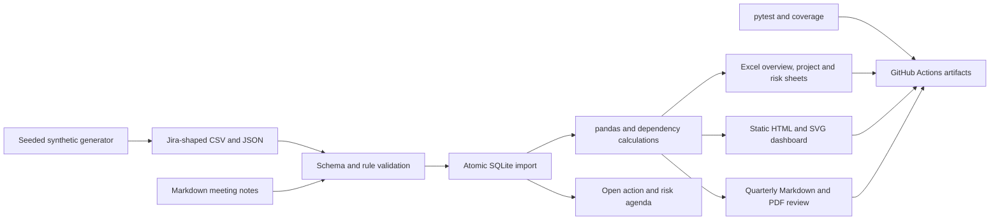

# Project portfolio tracker

An offline department portfolio lab in Python 3.11, SQLite and pandas. It consolidates Jira-style CSV or JSON exports, reports data problems, calculates delivery and capacity indicators, and creates an Excel workbook, a static HTML dashboard, and a quarterly review in Markdown and PDF. Meeting agendas and agreed actions use the same stored portfolio.

All projects, people, risks and status updates are synthetic. There is no live Jira connection, external service, API key or account setup. For this task, installation, tests, report generation and rendering run only in GitHub Actions. Nothing needs to be installed on your PC, and Docker is not used.

## Dashboard

The actual dashboard screenshot will be added from a completed CI run. CI captures the generated HTML in Chromium, including a mobile view, and uploads both images as artifacts. It never loads remote chart code or fonts.

## Data flow



## Three commands

CI prepares Python and the dependencies automatically. In an already prepared Python environment, these are the three main commands:

```sh
portfolio generate-data --out data
portfolio validate --data data --db portfolio.sqlite
portfolio report --db portfolio.sqlite --out reports --as-of 2026-09-30 --quarter 2026-Q3
```

The console command is installed by the package. `python -m portfolio_tracker.cli` provides the same interface. The workflow installs the package on the runner with `python -m pip install -e '.[test,ci]'`. No local execution is required.

`validate --format json` imports the JSON exports instead of CSV. It reports every semantic finding in a readable, structurally valid set of exports. Missing files and malformed input include their filename. Invalid input returns `1`, and the previous database stays unchanged. Argparse usage errors return `2`. The CLI prints no exception traceback for input, filesystem or SQLite errors.

## Synthetic export format

The seeded generator creates 12 project plans, 150 issues, 8 members, milestones, dependencies, open and closed risks, weekly updates, planned workload allocations and tracked actions. These are dataset design sizes; the measured counts from the actual pipeline are saved in CI's proof JSON. Seed 2829 gives repeatable records. Dates are fixed in 2026 so results do not change with the runner clock.

Each table has both a `.csv` file and a `.json` array of records with the same column names:

| Table | Main fields |
| --- | --- |
| `projects` | Project key, Project name, Project lead, Start date, Due date, Priority, Goal |
| `issues` | Issue key, Project key, Summary, Issue Type, Status, Assignee, Start date, Due date, Original estimate (h), Remaining estimate (h), Priority, Dependencies, Milestone |
| `members` | Account id, Display name, Weekly capacity hours |
| `milestones` | Milestone key, Project key, Target date, Completed date, Issue keys |
| `risks` | Risk key, Project key, Summary, Owner, Due date, Probability, Impact, Status |
| `updates` | Project key, Week, Status, Summary, Next steps |
| `workload` | Issue key, Assignee, Week, Planned hours |
| `actions` | Action key, Project key, Summary, Owner, Due date, Status, Source |

Dates use `YYYY-MM-DD`; Week is a Monday. Dependencies and linked issue keys use semicolons. The header shape resembles Jira exports, with explicit related tables for portfolio fields. It is not a claim of compatibility with every Jira configuration or a native Jira backup.

Validation checks required values, unique and composite keys, owners, project and milestone references, dependency references and cycles, dates and date order, allowed statuses and priorities, finite numeric ranges, estimate consistency, and weekly allocation identity. Findings include the table, element key, rule code and clear message. An import replaces the stored snapshot only after validation succeeds. Re-importing a full export replaces prior actions with that export's actions; import meeting notes after refreshing an export if those agreements are not included in the source.

## Calculation rules

| Indicator | Rule |
| --- | --- |
| Project progress | `100 * (sum original hours - sum remaining hours) / sum original hours`. With only zero estimates, use the fraction of Done tasks. An empty project is 0 percent. |
| Milestone delay | Positive calendar-day difference between target and actual completion, if supplied. Otherwise, use the latest linked task due date, with a floor at the review date when linked work is unfinished. No linked tasks means the target is retained. |
| Critical path | Finish-to-start CPM with zero lag and inclusive Monday to Friday task durations. A forward and backward pass calculate earliest times and slack. Cross-project links are included in the department network. |
| Blocked tasks | Open tasks explicitly marked Blocked, or waiting for any predecessor that is not Done. |
| Overdue actions | Open actions with due date strictly before the review date. An action due today is not overdue. |
| Risk exposure | Sum of probability times impact for open risks. Probability is 0 to 1; impact is 1 to 5. This is a score, not a monetary estimate. |
| Weekly workload | Sum of explicit Planned hours per person and Monday week, using pandas grouping. Capacity comes from each member's record. |
| Conflicting priorities | Person-weeks above that person's capacity, with the contributing projects, task priorities and excess hours listed. Equality with capacity is not overload. |
| Status gaps | No weekly update in the review quarter within 14 days of the review date. Future updates are excluded. |
| Calculated project status | Off track when maximum milestone delay exceeds 7 days. Otherwise At risk for any delay, blocker, or exposure of at least 2. Otherwise On track. The latest reported status is retained separately. |

The quarterly report is a snapshot within the chosen quarter. Workload and status updates are limited to quarter weeks through the review date. Plans, open risks, actions and future targets remain visible so management can consider the next decisions. The review includes goals, date commitments, stale status evidence, workload conflicts, delayed milestones, the critical path, open risks, overdue actions and recommendations tied to those measured counts.

CPM describes the dependency network, not a resource-feasible delivery forecast. It does not enforce task release dates, holidays, leave, dependency lag, working calendars or resource leveling. Weekday duration and workload hours are different measures. Weekly allocations are planned commitments and may involve collaborators other than an issue's single assignee. They are not timesheets or an automatic reconciliation to estimates.

## Reports and meeting support

The Excel workbook starts with Overview, followed by one sheet per project, Risks, Workload and Actions. Dates and numbers use typed cells. Filters, frozen identifiers, wrapped descriptions, progress bars and bounded conditional formatting support review. Blue zero-slack cells identify network-critical tasks; red delay or overload cells identify exceptions. It is a static snapshot. Editing workbook values does not rerun the Python calculations.

The dashboard has project status, a milestone timeline, a workload heatmap, open risks and management decisions. It uses plain SVG and CSS, with no JavaScript library or network dependency. Imported text is escaped in HTML, Markdown tables and PDF text. Excel text cannot introduce formulas.

`portfolio agenda --db portfolio.sqlite --out agenda.md --as-of 2026-09-30` creates a meeting agenda from open actions and risks, ordered by due date or exposure.

`portfolio notes --db portfolio.sqlite --file examples/meeting-notes.md` imports agreements written as:

```text
- [ ] P01 | m01 | 2026-10-07 | Confirm the cross-project acceptance threshold
```

The four fields are project, member id, ISO due date and action summary. Other prose and checked items are ignored. All invalid agreements are reported with line numbers before any change is saved. Duplicate agreements have stable ids and do not create duplicate tracked actions. The summary cannot contain a pipe character because it separates fields. This parser handles explicit agreements; it does not infer actions from free-form language.

## Tests and measured CI results

Tests use small hand-made examples to check the eight-business-day critical path, parallel branch slack, milestone delay, estimate-weighted progress, 48 hours against 40 hours of capacity, risk scores and due-date boundaries. They also test invalid imports, idempotent meeting notes, actual SQLite persistence, all five CLI commands, Excel cells and conditional rules, HTML escaping and real PDF text.

<!-- CI_METRICS_START -->
| Metric | Measured in CI |
| --- | --- |
| Tests and line coverage | Awaiting a completed CI run |
<!-- CI_METRICS_END -->

CI requires at least 40 pytest cases and at least 85 percent line coverage. The result table will use actual JUnit and coverage XML reports. Source counts or estimates are not presented as measured tests or coverage.

On every push, GitHub Actions runs Ruff, pytest, the complete CLI pipeline on both export formats, repeated notes import, agenda creation and report generation. LibreOffice renders the actual workbook to PDF on the runner. Chromium captures desktop and mobile dashboard screenshots. PDF pages are rendered to PNG, and text is checked for page overflow. These checks supplement visual inspection; they do not establish universal Microsoft Excel compatibility or full accessibility compliance.

The `portfolio-results` artifact includes the Excel workbook, self-contained HTML dashboard, Markdown and PDF review, agenda, synthetic exports, SQLite snapshots, screenshots, native workbook PDF, all PDF page previews, test and coverage reports, pipeline proof, visual proof, dependency versions and logs. Artifacts are retained for 14 days.

## Limitations

This is a synthetic offline lab, with no real company data and no live Jira connection. It has no authentication, hosted application, scheduled sync, multiuser editing, automatic issue updates or enterprise Jira schema mapping. CSV and JSON must use this documented subset. Validation cannot prove that a plan is realistic or that an owner's estimate is accurate. Risk scores and status thresholds are explicit demonstration rules, not calibrated prediction models.

The PDF uses bundled Bitstream Vera fonts. Font coverage does not support every writing system. SQLite stores a single validated snapshot; this is not an audit-history or concurrent workflow service. Report outputs can be regenerated from the stored data. No real-client delivery, availability or forecast accuracy is claimed.

Implementation references: [pandas CSV import](https://pandas.pydata.org/docs/reference/api/pandas.read_csv.html), [Python SQLite transactions](https://docs.python.org/3.11/library/sqlite3.html), [openpyxl conditional formatting](https://openpyxl.readthedocs.io/en/stable/formatting.html), and [Playwright screenshots](https://playwright.dev/python/docs/screenshots).
